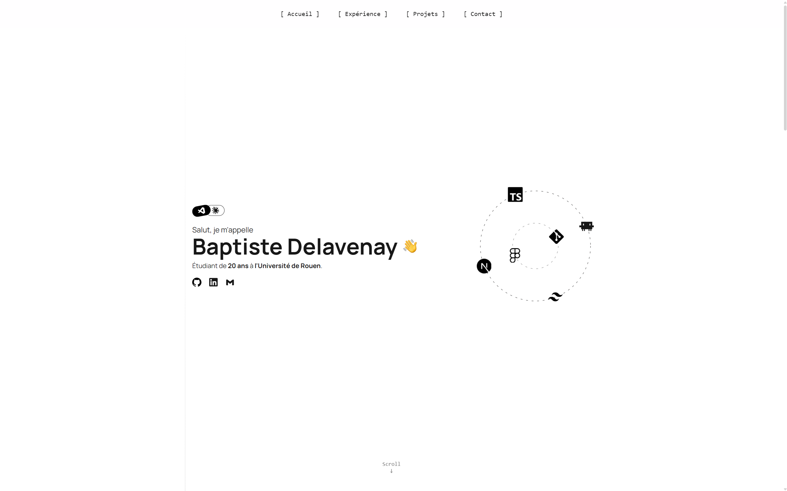
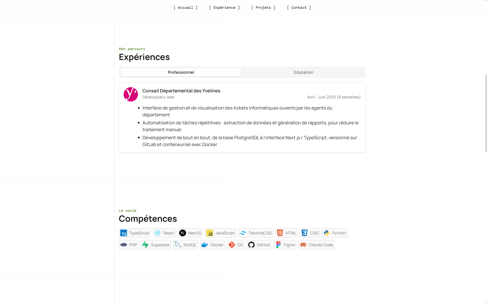
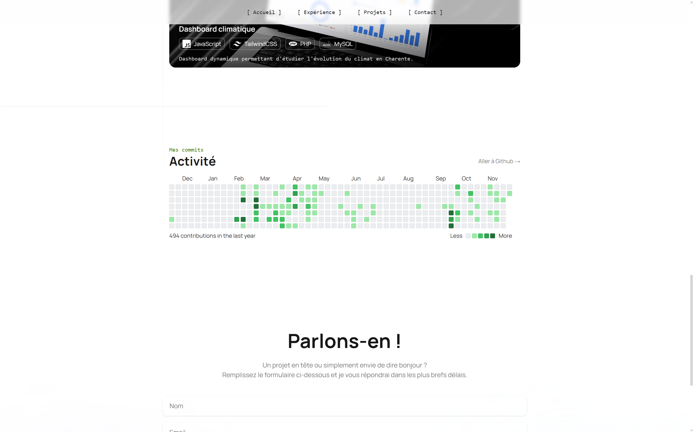
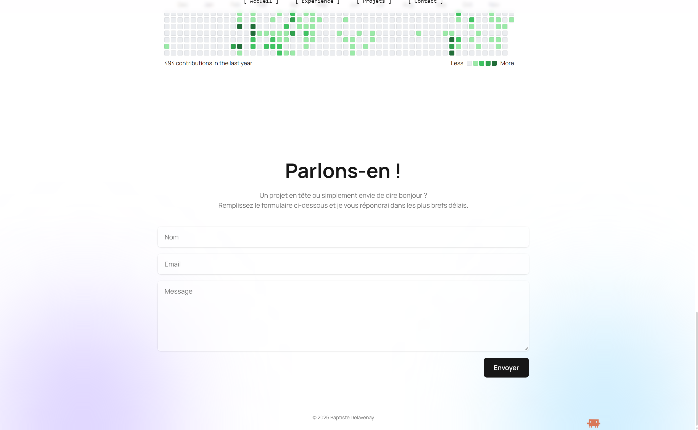

# Baptiste Delavenay — Portfolio

Mon portfolio de développeur web : parcours, compétences, projets et activité GitHub, sur une seule page sobre et responsive.



## Aperçu

| Expériences & compétences | Projets & activité GitHub |
|---|---|
|  |  |



## Fonctionnalités

- **Hero plein écran** avec orbite animée des technos que j'utilise et une invitation au scroll
- **Expériences** : onglets Professionnel / Éducation
- **Compétences** sous forme de badges
- **Projets** en cartes, chacune avec sa propre page de détail (`/projet/[id]`)
- **Activité GitHub** : calendrier des contributions de l'année
- **Formulaire de contact** fonctionnel (via [Web3Forms](https://web3forms.com))
- Navigation qui centre la section ciblée à l'écran, animations d'apparition au scroll
- **Responsive** du mobile au grand écran, respect de `prefers-reduced-motion`

## Stack

- [Next.js 16](https://nextjs.org) (App Router) + React 19 + TypeScript
- [Tailwind CSS 4](https://tailwindcss.com)
- [Framer Motion](https://motion.dev) pour les animations
- [react-github-calendar](https://github.com/grubersjoe/react-github-calendar)

## Lancer le projet

```bash
npm install
npm run dev
```

Puis ouvrir [http://localhost:3000](http://localhost:3000).

Build de production :

```bash
npm run build
npm start
```

## Structure

```
app/
├── page.tsx              # Page d'accueil (toutes les sections)
├── projet/[id]/page.tsx  # Page de détail d'un projet
├── Data/data.tsx         # Contenu : expériences, éducation, technos, projets
├── Data/assets.js        # Chemins des images
└── globals.css           # Thème (couleurs, police) et animations
Components/
├── section/              # Sections de la page (Header, Hero, Experience, Footer…)
└── ui/                   # Petits composants réutilisables
public/assets/            # Images des projets, logos, captures du README
```

## Modifier le contenu

Tout le contenu vient de `app/Data/data.tsx` : pour ajouter un projet, ajoute une entrée dans `dataProjet` (avec ses images déclarées dans `assets.js`). Sa carte sur l'accueil et sa page `/projet/<id>` sont générées automatiquement.

## Contact

- GitHub : [@BaptisteDelavenay](https://github.com/BaptisteDelavenay)
- LinkedIn : [Baptiste Delavenay](https://www.linkedin.com/in/baptiste-delavenay-230658273/)
- Email : delavenaybaptiste@gmail.com
